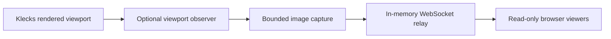

# Live Draw with Klecks

Draw in Klecks and let an audience follow the current drawing area in a browser.
One presenter controls each session. Viewers see live ink, zoom, pan, rotation,
mirroring and applied edits, with no drawing tools or editing permissions.

Live Draw is an independently named MIT-licensed companion to
[Klecks by bitbof](https://github.com/bitbof/klecks). It uses Klecks' existing
drawing engine and a small integration patch. It is not an official Kleki service.
The first implementation is ready for local review; physical iPad Safari and
Apple Pencil acceptance remains required before an iPad release claim.

## Run locally

Use Node.js 22 or newer, npm and Git. The container uses Node.js 24.

```sh
npm ci
npm run prepare:klecks
npm run build
npm run check
npm test
npm start
```

Open `http://127.0.0.1:5055`. Start a live session, copy its viewer link and open
that link in another browser tab. Draw normally. The audience follows the exact
visible drawing area, letterboxed to fit its screen. You can also share the
viewer window in a video meeting. Export PNG or layered PSD directly from the
presenter page. Stop sharing to clear viewers and invalidate the session links.

Local startup binds only to loopback. An iPad cannot reach this address on a
different device. Use the HTTPS setup in [DEPLOYMENT.md](docs/DEPLOYMENT.md) for
network access. The application does not automatically load `.env`; use
`node --env-file=.env server/index.mjs` if you create a local environment file.

For a local Mac/iPad acceptance session, see [IPAD_TEST.md](docs/IPAD_TEST.md).
It provides a temporary HTTPS setup and explicit device certificate installation
steps, with generated keys excluded from Git, Docker and source packages.

The build fetches the exact public Klecks revision in `upstream.json`, applies
`patches/klecks-viewport.patch` and builds the embedded editor. For an existing
checkout containing that revision, `npm run prepare:klecks -- --from /path/to/klecks`
avoids the Git download. Preparation replaces only the generated `.build/klecks`
directory. `npm test` includes an asset integration check and therefore follows
the first build.

## Editor access

When `HOST_ACCESS_KEY` is set, the editor defaults to private. Sign in with the
**Presenter password** before the drawing tools load. **Remember this device**
reuses that authorization on later visits. The server also protects direct
requests for editor pages, scripts and Klecks bundles. Shared viewer links remain
read-only and do not require presenter sign-in.

Set `EDITOR_ACCESS=public` to let visitors load the editor and draw locally;
broadcasting still requires the presenter password. Set `EDITOR_ACCESS=private`
to require sign-in explicitly; this setting requires `HOST_ACCESS_KEY`. Keyless
loopback development defaults to public. Compose defaults to private, and the
local HTTPS helper accepts the same environment setting.

This controls downloads from this server. Drawing code already loaded in a
browser remains local; forgetting a device does not discard its open drawing.

## Sharing and recovery

- Sharing starts off. Drawing and exports remain in the presenting browser.
- On a password-protected server, enter the **Presenter password** before opening
  the private editor, or on the first start if the editor is public. This is the
  existing `HOST_ACCESS_KEY` supplied by the operator.
  Select **Remember this device** on your own device to enable one-click starts
  for up to 30 days. Leave it unchecked on shared devices: access then uses a
  browser-session cookie with an eight-hour server expiry. Cookies must be
  enabled for this site. The app never saves the password in browser storage.
- Stop sharing, then choose **Forget this device** to revoke this browser's
  presenter login. Other devices keep their own logins. Server restart clears
  all device logins, so enter the password again after restarting the relay.
- Anyone with the viewer link can watch until the session ends or expires.
  The link contains a viewer capability in its fragment. Presenter control uses
  a separate capability retained only in the presenter's `sessionStorage`.
- Sessions last four hours by default. Presenter disconnects have a two-minute
  recovery window; viewers cannot extend it. Each presenter connection gets a
  fresh epoch and must send a new image before becoming live.
- Hidden presenter pages pause capture. Returning to the page sends a fresh
  view. Browsers may suspend networking while locked; physical iPad testing
  must confirm the actual device's recovery behaviour.
- The relay keeps only the latest complete image in memory. Stop, expiry and
  server restart end the session. There is no server recording or project store.
- Export work before reloading or closing the presenter. The embed does not
  persist your project or restore it after a reload.

The default viewer limit is 25. This is an enforced limit and a synthetic test
size, not a measured production capacity promise. Images are capped at a longest
edge of 1600 pixels, 10 updates per second and 2 MiB per frame. Idle artwork
does not generate periodic capture calls. This initial implementation sends
complete images; bandwidth increases with visual complexity and viewer count.

Presenter device access requires HTTPS for network use. Plain HTTP remains
supported for loopback development. QR pairing, durable logins across server
restarts and drawing autosave are not implemented in this milestone.

## Design



The viewport observer exposes a canvas and the actual rendered transform after
rendering completes. It is independent of the network protocol. With no
subscribers, ordinary Klecks use performs no capture encoding or network work.
The companion keeps one encoder and one latest pending view. Sequence numbers
and epochs prevent stale frames from replacing newer views. Slow viewers are
disconnected when their outgoing queue exceeds its budget.

The shared image excludes toolbars, dialogs, brush cursors and SVG selection
handles. Applied operations reach the audience; dialog previews stay local.
An optional embed parameter enables Klecks' existing canvas resize, crop and
rotate controls. Multi-user editing, audio/video calls, recordings, accounts and
independent viewer navigation are outside this first milestone.

## Contribute and self-host

See [CONTRIBUTING.md](CONTRIBUTING.md) for the upstream patch workflow,
[DEPLOYMENT.md](docs/DEPLOYMENT.md) for Docker and HTTPS configuration, and
[ACCEPTANCE.md](docs/ACCEPTANCE.md) for device testing and current evidence.

The companion's licence is [LICENSE](LICENSE). Klecks' unchanged copyright and
MIT terms are in [UPSTREAM_LICENSE](UPSTREAM_LICENSE) and the built editor's
`/klecks/LICENSE`. Klecks' library and font notices remain available through
its Settings → Licenses dialog and in the pinned upstream source. The `ws`
runtime dependency carries its MIT licence in its package. Preserve these
notices when distributing source or built assets.

The source pin, npm lockfiles and Docker base digests make source preparation
repeatable. Build-stage operating-system packages can change; this is not a
claim of byte-identical container builds. Deployment uses the exact tested
and scanned image digest.

The guarded online-test pipeline is documented in [ACTIONS.md](docs/ACTIONS.md).
Ordinary pushes run checks; deployment requires an explicit manual main run.
See [SECURITY.md](docs/SECURITY.md) for the access boundaries, image gate and
reviewed build-only exception.
